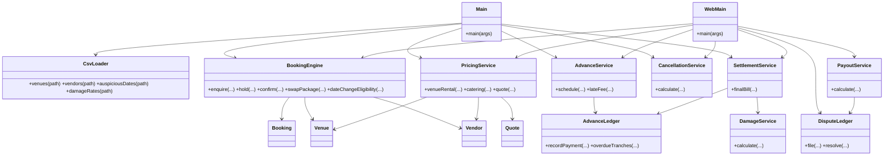

# PS-108 Design Document

## 1. Purpose
Implement a Java 17+ command-file-driven booking engine for venue enquiries, temporary holds, vendor packages, staged advances, cancellations, date changes, event settlement, commissions, and dispute-controlled payouts. The local website is an extra demonstration surface; the command-line workflow is the assignment path.

## 2. Architecture
- `model`: immutable/mostly immutable records for venues, vendors, bookings, quotes, and money outcomes.
- `io`: CSV parsing and command input.
- `service`: pricing, hold queue, advance schedule, cancellation, and settlement business logic.
- `Main`: command-line entry point and output orchestration.
- `WebMain`: Java built-in HTTP server exposing venue/vendor registration, quote, enquiry, hold, confirmation, payment, cancellation, package swap, date change, actuals, settlement, dispute, and payout endpoints.
- `src/main/resources/static`: responsive customer website and booking-operations dashboard in HTML, CSS, and JavaScript.
- `test`: JUnit tests for boundaries and financial calculations.

### 2.1 Class and component relationships

### 2.2 Booking lifecycle

```mermaid
stateDiagram-v2
    [*] --> ENQUIRED
    ENQUIRED --> HELD: hold requested and slot available
    ENQUIRED --> CANCELLED: declined or invalidated
    HELD --> CONFIRMED: booking confirmed
    HELD --> CANCELLED: 72-hour expiry; promote FIFO enquiry to a new HELD booking
    HELD --> CANCELLED: explicit cancellation
    CONFIRMED --> CANCELLED: client cancellation or 21+ day overdue advance
    CONFIRMED --> COMPLETED: event close and actuals recorded
    COMPLETED --> SETTLED: final bill calculated
    CANCELLED --> [*]
    SETTLED --> [*]
```

The in-memory website additionally stores enquiry queue entries and hold expiry timestamps. On the first advance payment, competing queued enquiries for that date and slot are cleared. Persistence is not provided by the current implementation.

## 3. Requirement traceability
| Rule | Main implementation | Validation focus |
|---|---|---|
| BR-01 | `BookingEngine` hold queue | expiry, FIFO promotion, confirmation clears queue |
| BR-02 | `PricingService.venueRental` | weekend/auspicious max; two-slot discount |
| BR-03 | `PricingService.catering` | guarantee and +10% premium boundary |
| BR-04 | `BookingEngine.swapPackage` | 30-day fee boundary |
| BR-05 | `AdvanceService.schedule` | 60-day and 7-day boundaries |
| BR-06 | `AdvanceService`, `AdvanceLedger`, and command orchestration | grace, started weeks, 21-day auto-cancel policy |
| BR-07 | `CancellationService.calculate` | ladder boundaries and cap |
| BR-08 | `CancellationService` | photography/catering overrides |
| BR-09 | `BookingEngine.dateChangeEligibility` | >90 days and 180-day destination boundary |
| BR-10 | `SettlementService.finalBill` | taxes and advances |
| BR-11 | `PayoutService` and `DisputeLedger` | commissions, 7-day release, and dispute freeze |
| BR-12 | service orchestration | documented precedence and tests |

## 4. Key data
- Venue: ID, name, capacity, weekday rental, available slots.
- Vendor: ID, name, category, package prices, catering tier rates, commission rate.
- Booking: client, venue/date/slot, guest counts, selected packages, status, paid advances, hold expiry.
- Payment tranche: due date, principal, paid amount, late fee.
- Settlement: venue, catering, packages, switch fees, damages, taxes, advances, balance, vendor payouts.

## 4.1 CSV input formats
Files are UTF-8 CSV with a header row (headers are ignored by the loader). Commas, quoted commas, doubled quotes, and quoted multiline fields are supported. Blank and comment rows are ignored. IDs must be unique within their table.

| File | Columns in order | Example data row |
|---|---|---|
| `data/venues.csv` | `venue_id,name,capacity,weekday_base,slots` | `V001,Lotus Hall,500,250000,DAY;NIGHT` |
| `data/vendors.csv` | `vendor_id,name,category,packages,commission_rate` | `D001,Petal Decor,DECOR,CLASSIC:50000;PREMIUM:85000,0.15` |
| `data/auspicious-dates.csv` | `date` | `2027-05-01` |
| `data/damage-rate-card.csv` | `damage_code,description,rate` | `CHAIR,Chair damage,2500` |

Venue slots are `DAY` and/or `NIGHT`, separated by semicolons. Vendor category is `CATERING`, `DECOR`, or `PHOTOGRAPHY`; packages are `NAME:PRICE` pairs separated by semicolons. Catering package names are menu tiers such as `SILVER`, `GOLD`, and `PLATINUM`. Rates and commission values are decimal numbers; commission is represented as a fraction (for example `0.12` means 12%). The command entry point accepts the three main tables and command file; auspicious dates and damage rates are loaded from the project `data` directory by the application.

## 5. Command processing
Input is one event per line. Timestamp ordering is ascending; equal timestamps preserve source line order. Before each event, expire all holds whose expiry timestamp is less than or equal to the event timestamp. This makes an incoming request at the exact expiry timestamp eligible for the next queue position after the expired hold is released.

## 6. Financial formulas
- Venue rate: weekday base × highest applicable multiplier; day+night second slot is discounted 10%.
- Catering guarantee: max(ceil(quoted guests × 0.8), 150).
- Catering bill: plates at normal rate through quoted guests + 10%; any plates above that threshold are charged at 1.2× rate. Minimum guarantee affects billed plates.
- Cancellation: calculate vendor-specific line forfeitures first, general ladder for remaining applicable value, then cap total forfeiture at paid advances + ₹25,000.
- Advance schedule: 25% at confirmation, 50% at T−60, balance at T−7; within 60 days the first two tranches merge; within 7 days all is due at confirmation.
- Late advances: 5-day grace; charge 1% for each started 7-day period after grace. The first charge applies on overdue day 6 and the next on day 13. At 21+ days overdue, auto-cancel under the ladder as of that date.
- Final bill: venue + catering actual + packages + switch fees + rate-card damages + GST − advances. GST is 18% on venue and packages and 5% on catering without ITC; tips are excluded.
- Commission: venue 12%, catering 8%, decor/photography 15%.
- Dispute freeze window: count 48 hours from the recorded event-close timestamp; only a matching open dispute filed by the payout evaluation time freezes that vendor's payout.

## 6.1 Edge cases required by the brief
- Expire a hold before processing a new enquiry at its exact expiry time, then promote the next queued enquiry.
- On a weekend auspicious date, apply 1.6× rather than stacking multipliers.
- At exactly 60 days, merge the first two advance tranches.
- At exactly quoted guests + 10%, do not apply the catering premium rate.
- Cancellation exactly 90 days before uses the 50% ladder band.
- A change requested 91 days before the old event to a date 181 days out is not free; apply cancellation and replacement credit.
- Cap any forfeiture at advances paid plus ₹25,000.
- Evaluate a 21-day overdue advance on the event date before processing that date's command.

## 7. Validation and error handling
Reject unknown IDs, invalid dates, negative guest counts or money, invalid slots, unknown package tiers, duplicate IDs, and invalid state transitions. Errors must identify the source command and not silently skip records.

## 8. Website scope and limitations
- Start `in.ps108.WebMain` from the project root and open `http://localhost:8080`; open `http://localhost:8080/admin.html` for operations.
- The customer site calls the Java pricing/booking engine. The operations dashboard exposes venue/vendor registration, enquiry and hold creation, queue visibility, confirmation, payment schedule and simulated payments, cancellation outcomes, package swaps, date changes, post-event actuals, settlement, disputes, payout status and printable reports.
- All runtime state, including registrations, bookings, payments and disputes, is in memory and is lost when the server stops. This is a local demo, not a production booking platform; it has no database, authentication or real payment integration.
- New venue/vendor registrations are session-only and are not written to CSV.
- Date-change fallback displays capped forfeiture and 50% credit; `APPLY_CREDIT` redeems available credit against a confirmed replacement booking before payments.
- The local server binds to `127.0.0.1`; this is intended for local demonstration, not public deployment.
- Browser print actions can print/save quote, payment schedule, cancellation, settlement, payout and other report views as PDF.

## 9. Acceptance baseline and scope
- `data/self-authored-acceptance/` and `docs/self-authored-acceptance-checks.md` define the project's local expected-output baseline; the command sample output is also checked exactly.
- No organizer-specific fixtures are present. Their exact formatting cannot be certified without those files, but this does not block project completion against the available brief.
- The CLI is the required no-UI deliverable. The website is retained as a supplemental demo.
- The project resolves the unspecified partial-week late fee and dispute timestamp by explicit policies documented in `decision-log.md`.
- Late fees remain separate from final settlement because the stated final-bill formula omits them.
